<!-- Replace docs/assets/logo-placeholder.svg with your own logo (an SVG or PNG around 160x160 works best). -->
<p align="center">
  
</p>

<h1 align="center">Dialer UI</h1>

<p align="center">
  <b>A modern light and dark interface for the VICIdial agent screen, delivered as a Chrome extension.</b><br>
  No server changes. No PHP patches. VICIdial keeps doing all the work underneath.
</p>

<p align="center">
  
  
  
  
</p>

<p align="center">
  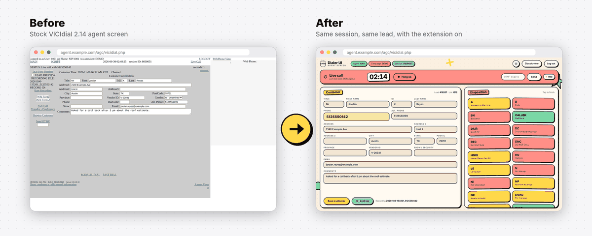
</p>

---

## Contents

- [Why](#why)
- [Before and after](#before-and-after)
- [What the conversion changes](#what-the-conversion-changes)
- [Screen effects](#screen-effects)
- [Number lookup](#number-lookup)
- [How it works](#how-it-works)
- [Install](#install)
- [Configuration](#configuration)
- [Project structure](#project-structure)
- [Safety and privacy](#safety-and-privacy)
- [Troubleshooting](#troubleshooting)
- [Version history](#version-history)
- [Roadmap](#roadmap)

## Why

The stock VICIdial agent screen is built from image buttons, tables and pop-up layers that date back many years. It works, but agents have to hunt for the state they are in, the phone number is small text, and finishing a call takes several clicks across two screens.

This extension redraws the agent screen and the login page with a clean, responsive interface. It does not replace VICIdial. It sits on top of the page, reads VICIdial's live state, and presses VICIdial's own buttons for you. Recordings, call logs, callbacks, the softphone and reporting all behave exactly as before.

## Before and after

<p align="center">
  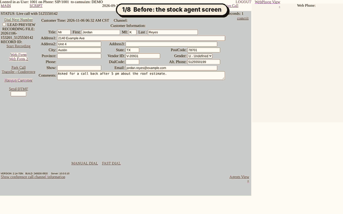
</p>

### Side by side

<table>
  <tr>
    <th width="50%">Before: stock VICIdial</th>
    <th width="50%">After: with the extension</th>
  </tr>
  <tr>
    <td colspan="2"><b>Waiting between calls (paused)</b></td>
  </tr>
  <tr>
    <td>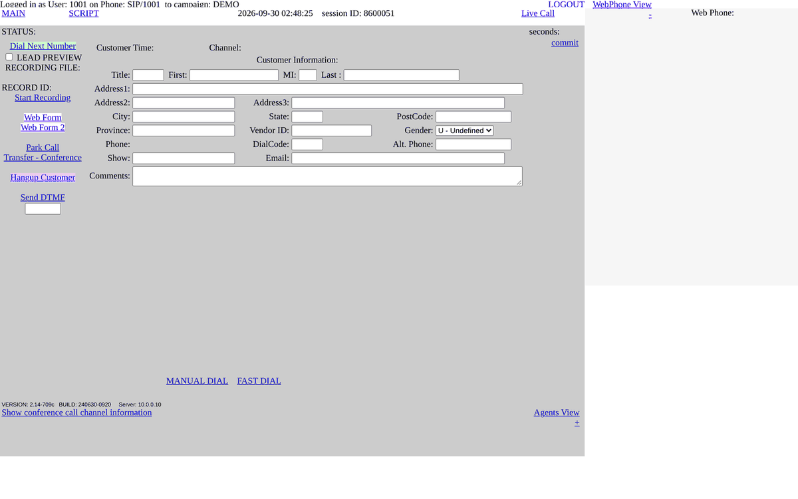</td>
    <td>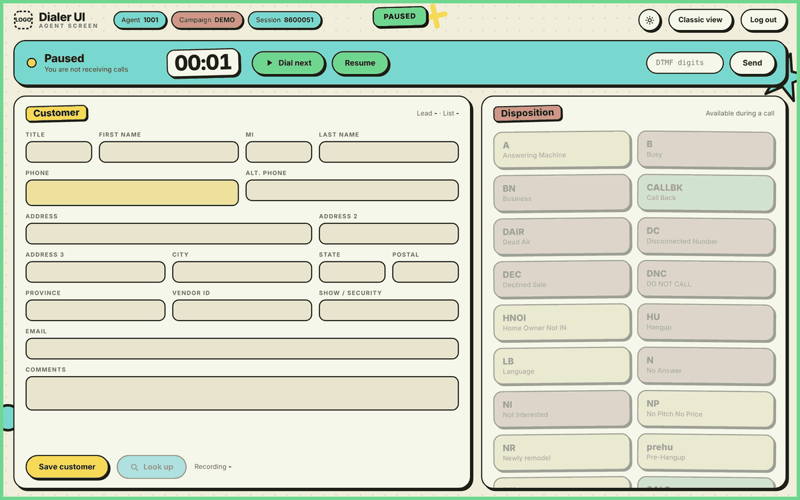</td>
  </tr>
  <tr>
    <td colspan="2"><b>On a live call</b></td>
  </tr>
  <tr>
    <td>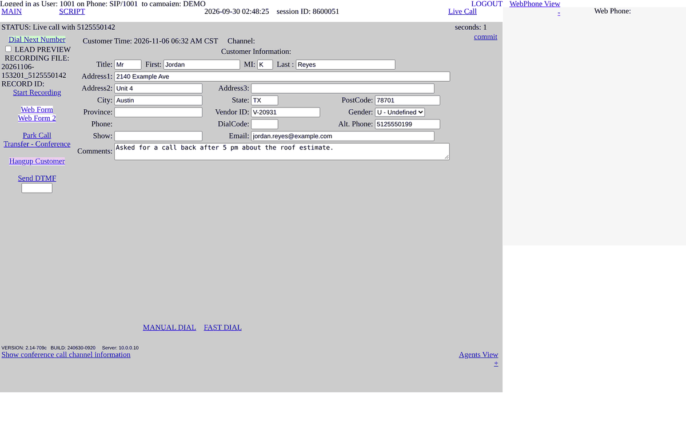</td>
    <td>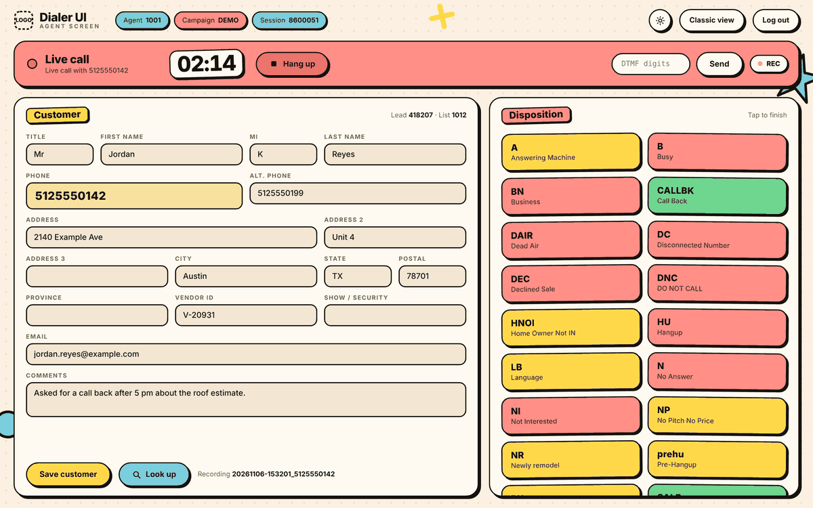</td>
  </tr>
</table>

### What you see at a glance

| | Before | After |
|---|---|---|
| **Current state** | A line of small text next to `STATUS:` | A coloured status strip with a large label, a pulsing dot and a timer |
| **Call timer** | `seconds:` counter in the corner | Large `mm:ss` timer in the status strip |
| **Phone number** | Plain text inside the form | Highlighted, large field at the top of the customer card |
| **Finishing a call** | Hang up, wait for the disposition pop-up, pick a status, press Submit | One click on a disposition button hangs up and saves |
| **Dispositions** | Hidden until after the hang up | Always on screen, colour coded by outcome, unlocked during a call |
| **Paused / call ended** | No visual change | Green wash while paused, red wash until a disposition is picked |
| **Confirmation** | None | Full-screen flash with the code and name of the disposition |
| **Theme** | Fixed grey | Light and dark, remembered per browser |
| **Small screens** | Fixed-width tables | Responsive layout down to phone width |

### States the stock screen does not show

<table>
  <tr>
    <td width="50%">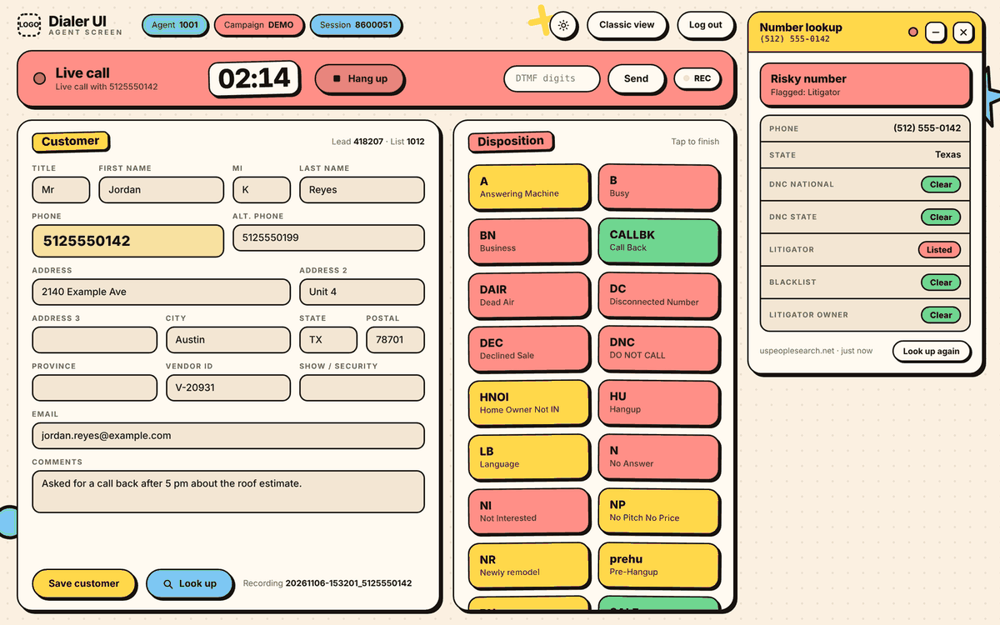<br><sub><b>Number lookup.</b> One click checks the lead's number and shows a verdict in a sidebar.</sub></td>
    <td width="50%">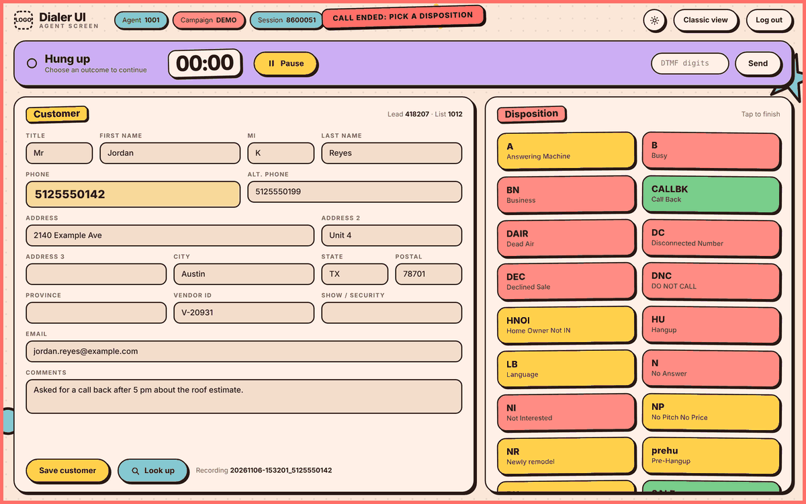<br><sub><b>Hung up.</b> A red wash and a tag stay until a disposition is picked.</sub></td>
  </tr>
  <tr>
    <td>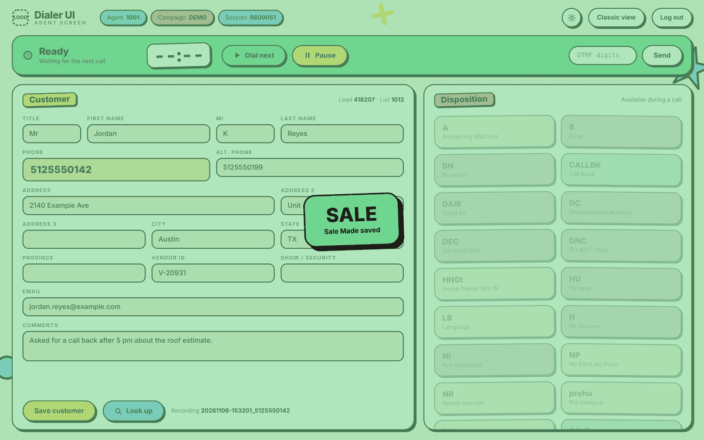<br><sub><b>Disposition saved.</b> A full-screen flash confirms the code, coloured by outcome.</sub></td>
    <td>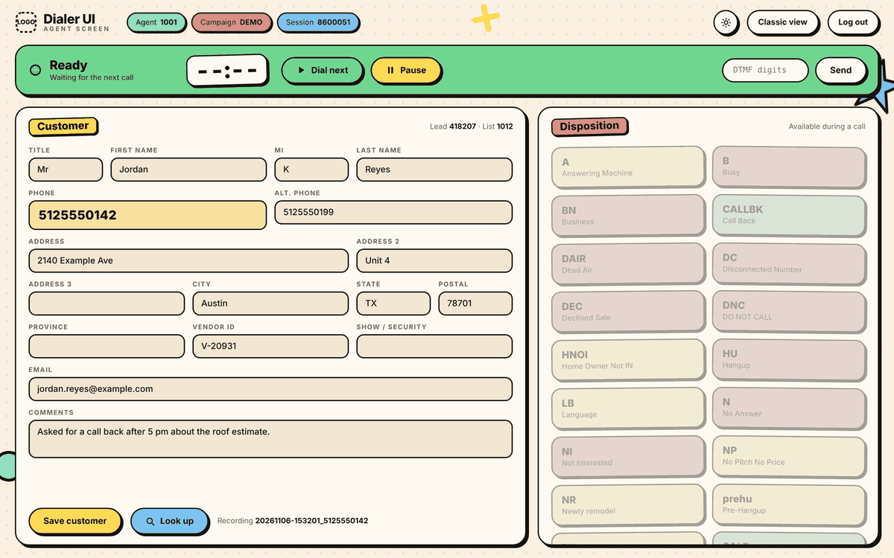<br><sub><b>Ready.</b> Green strip, Dial next and Pause within reach.</sub></td>
  </tr>
  <tr>
    <td>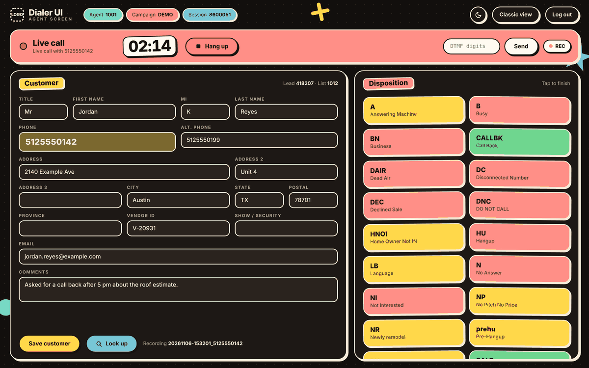<br><sub><b>Dark mode.</b> Toggle with the sun and moon button. The first load follows the system theme.</sub></td>
    <td align="center">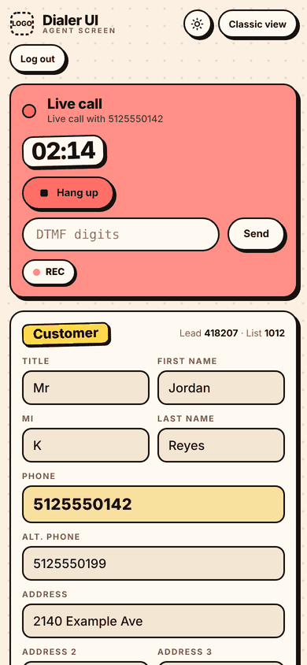<br><sub><b>Phone width.</b> Panels stack into one column below 1000 px.</sub></td>
  </tr>
</table>

> Screenshots use demo data. The agent ID, session, server address and customer are placeholders.

## What the conversion changes

Every control in the new UI maps to something that already exists in VICIdial. The extension mirrors the values into VICIdial's own fields and calls the same JavaScript functions the native buttons call.

| Stock VICIdial | New UI | What runs underneath |
|---|---|---|
| `STATUS:` text, `seconds:` counter | Status strip: label, sub-line, timer, colour | Reads `VDRP_stage`, `VD_live_customer_call`, `#MainStatuSSpan`, `customer_sec` |
| "Logged in as User ... to campaign ..." line | Agent, Campaign and Session chips | Reads `user`, `campaign`, `#sessionIDspan` |
| **Dial Next Number** image button | **Dial next** | `ManualDialNext(...)` |
| Pause / Resume image button | **Pause** / **Resume** | `AutoDial_ReSume_PauSe("VDADpause")` / `("VDADready")` |
| **Hangup Customer** | **Hang up** | `dialedcall_send_hangup("YES", "")` |
| **Send DTMF** link and box | DTMF input and **Send** | Fills `#conf_dtmf`, then `SendConfDTMF(session_id, "YES")` |
| Customer Information form and `commit` link | Customer card and **Save customer** | Copies each field into the native input, then `CustomerData_update("YES")` |
| Disposition pop-up and Submit | Disposition grid, built from the campaign's own status list | During a call: `dialedcall_send_hangup("NO", "YES", code)` with VICIdial's hotkey flags, so it hangs up and saves in one step. After a hang up: `DispoSelect_submit("", "", "YES")` |
| `RECORDING FILE:` text | **REC** badge and the file name in the card footer | Reads `#RecorDingFilename` |
| **LOGOUT** | **Log out** | `NormalLogout()` |
| Login form | Two-panel sign-in page | Copies entries into `VD_login`, `VD_pass`, `phone_login`, `phone_pass`, `VD_campaign`, then `login_submit()`. The campaign list is pulled live through `login_allowable_campaigns()` |
| Not available | **Look up** | Background worker, see [Number lookup](#number-lookup) |
| Transfers, conferences, web forms, callbacks, manual dial, scripts | **Classic view** | Hides the overlay so the native screen takes clicks again. A floating pill brings the new UI back |

The disposition list is read from VICIdial at runtime (`VARstatuses`, with the campaign and system lists as fallbacks), so any status your admin adds shows up without code changes. Statuses marked not selectable are skipped.

### Effects for agents

- **Fewer clicks per call.** Disposition and hang up are one action instead of three or four.
- **State is impossible to miss.** Colour, label, timer and full-screen washes all change together.
- **Fewer missed dispositions.** The red wash stays until a disposition is saved.
- **Instant feedback.** Every saved disposition flashes on screen, including ones saved through VICIdial's own pop-up or hotkeys.

### Effects for admins

- **Nothing changes on the server.** No PHP edits, no database changes, no new services.
- **Rollback is one switch.** Disable the extension and the stock screen is back.
- **Reporting is untouched.** All actions go through VICIdial's own functions, so call logs, agent time and recordings are recorded the normal way.
- **Per-agent rollout.** Install it for one agent or the whole floor.

## Screen effects

The status strip, the orb and the full-screen washes are driven by one state value that the UI works out every 400 ms.

| State | Detected when | Strip | Screen effect | Timer shows |
|---|---|---|---|---|
| **Live call** | `VD_live_customer_call` is 1 | Coral | Pulsing dot, REC badge while recording | Call length |
| **Hung up** | VICIdial's disposition screen is open | Lavender | Red wash, red edge glow, "Call ended: pick a disposition" tag | Time since hang up |
| **Dialing** | Status text says ringing, dialing, calling or incoming | Sky blue | Pulsing dot | Time spent dialing |
| **Paused** | `VDRP_stage` is `PAUSED` | Teal | Green wash, green edge glow, "Paused" tag | Time paused |
| **Ready** | Any other agent stage | Green | None | `--:--` |
| **Idle** | No stage yet | Plain | None | `--:--` |

Disposition buttons and the confirmation flash share one colour code:

| Colour | Codes |
|---|---|
| Green (positive) | `SALE`, `XFER`, `CALLBK`, `CALLBACK`, `CBHOLD` |
| Red (negative) | `N`, `NI`, `DNC`, `DC`, `DAIR`, `B`, `HU`, `DEC`, `BN`, `HONI` |
| Amber (everything else) | Any other code, such as `A`, `LB`, `NP` |

To change which codes count as positive or negative, edit the `POS` and `NEG` sets in `app.js`.

## Number lookup

A **Look up** button sits next to **Save customer**. It does nothing until the agent clicks it.

1. The UI takes the lead's phone number and keeps it only if it is a 10-digit US number (a leading `1` is dropped).
2. The number goes to the extension's background worker, which fetches the lookup site once.
3. The worker reads the result as JSON if possible, otherwise from the page text, and returns six fields: **State**, **DNC National**, **DNC State**, **Litigator**, **Blacklist** and **Litigator owner**.
4. A sidebar shows a verdict on top:

| Verdict | When |
|---|---|
| **Clear** | No check is flagged |
| **Risky number** | Litigator, Blacklist or Litigator owner is flagged |
| **On a Do Not Call list** | Only a DNC check is flagged |
| **Incomplete result** | Some checks could not be read |

Results are cached for 10 minutes per number. The sidebar can be minimised, closes with the × button, and closes by itself when the lead changes. If the site refuses the request or the page cannot be read, the sidebar says so and offers **Copy number and open site** so the agent can check by hand.

> The lookup is a convenience check against a third-party site. It is not a substitute for your own DNC scrubbing or legal review.

## How it works

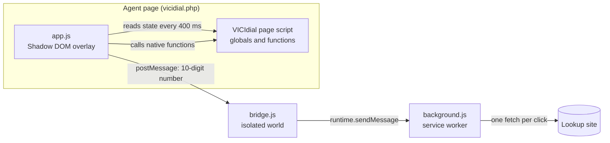

- **`app.js`** runs in the page's own JavaScript world (`"world": "MAIN"`), which is what lets it read VICIdial's globals and call its functions. It draws everything inside a Shadow DOM, so its styles never leak into VICIdial and VICIdial's styles never leak into it.
- **`bridge.js`** runs in the extension's isolated world. Page scripts cannot call extension APIs, so the UI posts a message here. The bridge accepts only a validated 10-digit number and forwards nothing else.
- **`background.js`** is the only part that makes a network request, and only for the lookup.

A one-click disposition during a live call:

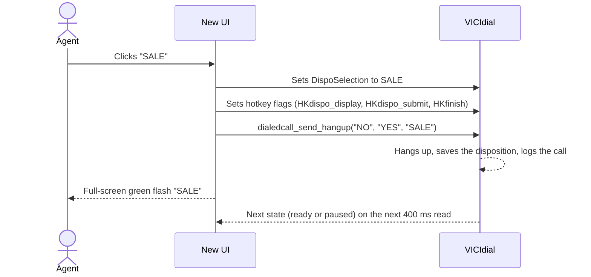

The UI only appears when the page really is an agent screen (`VDRP_stage`, a status list or `#DispoSelection` exists) or a login screen (`#login_sub` and the `VD_login` field exist). It retries for about 20 seconds after load, then gives up quietly.

## Install

Requires Chrome 111 or newer (or another Chromium browser with Manifest V3 and `world: "MAIN"` support; only Chrome has been tested).

1. Download or clone this repository.
2. Open `chrome://extensions`.
3. Turn on **Developer mode** (top right).
4. Click **Load unpacked** and pick the folder that contains `manifest.json`.
5. Open your VICIdial agent page (any URL containing `vicidial.php`). The new UI appears automatically.

When updating, click the reload icon on the extension's card, then refresh the agent page.

## Configuration

| Setting | Where | Notes |
|---|---|---|
| Lookup results page | `LOOKUP_URL` in `background.js` | The lookup site documents no API. Search a number on the site by hand, copy the results page address, and put `{phone}` where the number goes. |
| Lookup site permission | `host_permissions` in `manifest.json` | Must match the domain in `LOOKUP_URL`. |
| Which pages the UI runs on | `matches` in `manifest.json` | Default is `*://*/*vicidial.php*`. Narrow it to your own domain if you like. |
| Positive and negative codes | `POS` and `NEG` in `app.js` | Controls button and flash colours. |
| Editable customer fields | `EDIT_FIELDS` in `app.js` | Field id, label and grid width. |
| Theme | Toggle in the header or on the login page | Stored in the browser's local storage. |

## Project structure

```
.
├── manifest.json     Manifest V3: content scripts on *vicidial.php*, one host permission
├── app.js            Overlay UI, login page, state mirroring and actions (page world)
├── bridge.js         Relays lookup requests from the page to the worker (isolated world)
├── background.js     Number lookup: fetch, parse JSON or HTML, classify each check
└── docs/
    ├── assets/       Logo placeholder
    └── images/       README screenshots and walkthrough
```

## Safety and privacy

- **Never deletes or rewrites VICIdial's page.** The overlay sits on top and drives the same functions the native buttons do.
- **Classic view is always one click away** for anything not yet in the new UI, or if something looks off.
- **No servers of its own** and no analytics.
- **Outside requests:** the Google Fonts stylesheet for the UI fonts (the UI falls back to system fonts if it is blocked), and the lookup site, only when an agent clicks **Look up**.
- **Only one extra permission:** the lookup site's domain. No `tabs`, `storage` or `<all_urls>` permission is requested.

## Troubleshooting

| Problem | Fix |
|---|---|
| The new UI does not appear | Check that the page URL contains `vicidial.php`. Reload the extension, then refresh the page. |
| A feature is missing | Use **Classic view**. Transfers, conferences, web forms, callbacks and manual dial still live on the native screen. |
| "The lookup service did not respond" | The extension was reloaded after the page opened. Refresh the agent page. |
| "Could not read results from the site" | `LOOKUP_URL` does not point at the results page. See [Configuration](#configuration). |
| "The site refused the request (403 / 429)" | The site is blocking automated requests. Use **Copy number and open site**. |
| Fonts look different | The Google Fonts request was blocked. The UI works the same with system fonts. |

## Version history

| Version | Changes |
|---|---|
| **2.1** | Number lookup button, sidebar and background worker. |
| **2.0** | Light and dark mode, redesigned layout, green and red screen washes, disposition flash, colour-coded disposition buttons, redesigned login page, responsive layout. |
| **1.0** | First overlay: login mirroring, call actions, customer panel, live disposition grid, Classic view. |

## Roadmap

- Live captioning and call transcript
- AI assist and auto-fill of the sale form
- Transfers and conferences inside the new UI

## Credits

Made by @Saad.

VICIdial is open-source software by its respective authors. This project is an independent browser extension and is not affiliated with or endorsed by the VICIdial project.

## License

<!-- Add a LICENSE file and name it here, for example MIT. -->
No license has been chosen yet.
